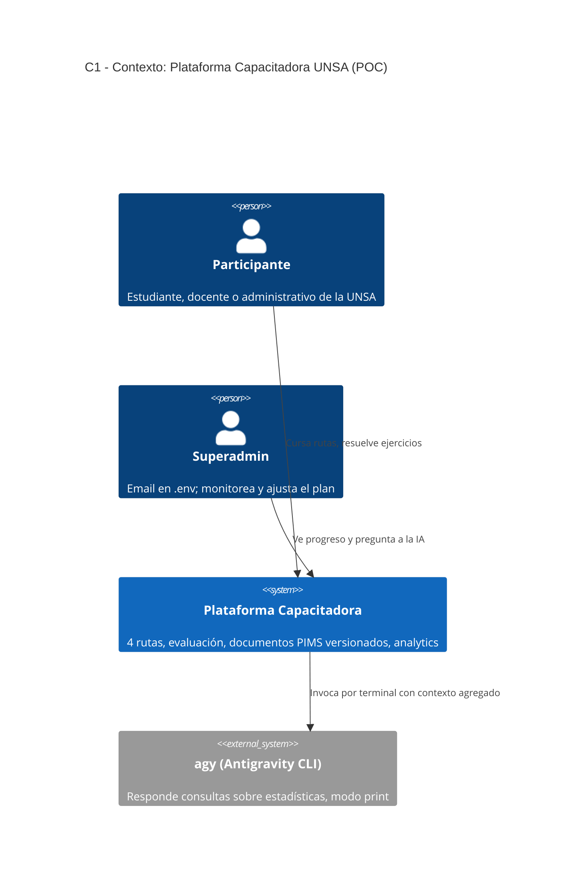
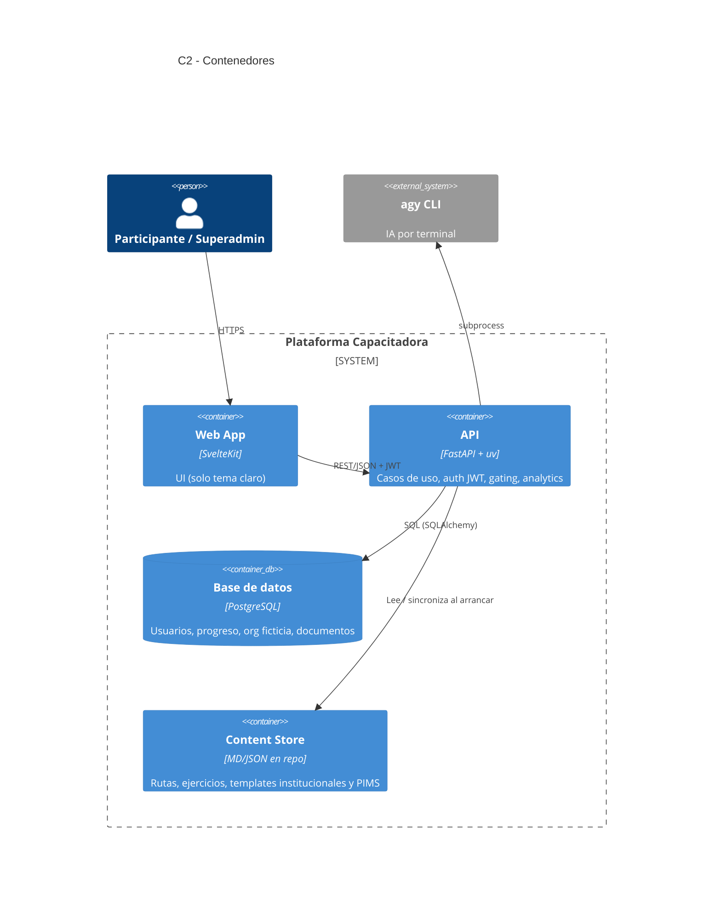
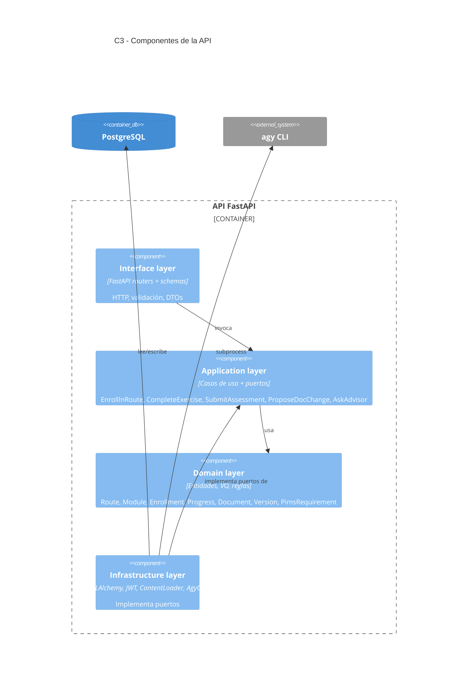

# Plan — Plataforma Capacitadora de Auditores Internos UNSA (POC)

> Estado: **plan v2 (no hay código aún)**. Documento vivo: se ajusta al cerrar cada fase.
> Toda la información de la UNSA es **ficticia** y solo con fines de prueba de concepto (POC).
> Cambios v2: metodología **Spec-Driven Development (SDD)**, integración real con `agy`, y **conjunto de información documentada del PIMS (ISO 27701)** integrado en documentos, rutas y evaluación.

---

## 1. Contexto

**Problema.** Estudiantes, docentes y administrativos conocen poco su propia universidad (quién decide qué, quién custodia qué datos, qué documentos norman cada cosa). Como consecuencia faltan auditores internos que conozcan *de verdad* la institución y puedan auditar lo más importante.

**Idea.** Aplicación de capacitación en **4 rutas secuenciales** (inspirada en el modelo de rutas de CISCO Networking Academy), con enfoque **práctico** (ejercicios interactivos > teoría), orientada solo a **auditores internos especializados en la universidad** (no auditores externos).

**Resultado esperado del POC.**
1. Una persona de la UNSA se matricula, recorre las rutas en orden y acumula horas/progreso.
2. El superadmin (email en `.env`) ve estadísticas por ruta y consulta a `agy` preguntas como *"¿Cómo están los alumnos de sensibilización?"*, recibiendo propuestas de ajuste del plan de enseñanza.
3. La documentación institucional ficticia (ROF, MOF, estatutos, cuadro de asignación de personal, **y el conjunto documental del PIMS**) vive como plantillas Markdown **versionadas** (estilo git) y alimenta el contenido y las prácticas de las rutas.
4. Existe un módulo de evaluación para roles **controller** y **processor**.
5. Hay una BD ficticia semipoblada de la universidad.

### Decisiones tomadas
| Tema | Decisión |
|---|---|
| Metodología | **Spec-Driven Development (SDD)** + Clean Architecture (ver §4). La spec es la fuente de verdad; el código y los tests se derivan de ella. |
| IA | El backend invoca **`agy` (Antigravity CLI) en modo `--print`** por subprocess, **sin API key** (POC), detrás de un puerto (`AnalyticsAdvisorPort`). |
| Auth | Email + password propios, **JWT**. Rol superadmin si el email = `SUPERADMIN_EMAIL` (`.env`). |
| Contenido | Español. **Ruta 1 completa**; Rutas 2–4 con estructura completa + **1 módulo demo interactivo** cada una. El set documental PIMS (§5) sí se incluye completo como plantillas. |
| Stack | SvelteKit (solo tema claro) · FastAPI + uv · PostgreSQL. |

### Supuestos a confirmar
- "SSD/SDD" = **Spec-Driven Development** (aclarado). Ya no se usa DDD como metodología; solo se conserva la separación en módulos por contexto como organización de código.
- **Numeración de cláusulas ISO 27701:** las referencias (4.3, 5.2, 6.1.2, 6.1.3 c/e/f, 7.2, 8.2, 8.3, 9.1, 10.2) son las sugeridas. Se guardan como **datos** (`pims_requirements.clause_ref`) y no hardcodeadas, porque la numeración difiere entre la edición 2019 (extensión de 27001) y la 2025 (norma independiente). Verificar contra la edición que use la UNSA.
- Contenido ISO **parafraseado y propio**, sin reproducir texto de la norma (copyright).
- Entorno local ya disponible: `uv 0.13`, `node 24`, `docker`, `psql`, y **`agy` instalado** (`~/.local/bin/agy`).

---

## 2. Alcance

**Dentro:** 4 rutas con gating secuencial, motor de ejercicios interactivos, evaluación controller/processor, documentos institucionales + set PIMS versionados, org-chart ficticio, panel superadmin con IA, seed de BD, documentación C4 (C1–C3), ADRs y specs SDD.

**Fuera (POC):** auditores externos, SSO institucional real, certificados con validez legal, multi-tenant, app móvil, tema oscuro, integración con sistemas reales de la UNSA, API keys de LLM.

---

## 3. Las 4 rutas (84 h en total)

Regla global: cada ruta **exige haber aprobado todas las anteriores**. Las horas se *acreditan* al completar lecciones/ejercicios (cada ítem declara sus minutos); una ruta se aprueba con 100 % de módulos obligatorios completados y evaluación final ≥ 70 %.

| # | Ruta | Horas | Prerrequisito | Pregunta que responde |
|---|---|---|---|---|
| 1 | **Sensibilización (Awareness)** | 12 | — | ¿Cómo funciona mi universidad y quién responde por qué? |
| 2 | **Interpretación** | 16 | Ruta 1 | ¿Qué exige ISO 27001 / 27701 y qué documentos lo evidencian? |
| 3 | **Implementación** | 24 | Rutas 1–2 | ¿Cómo se construye y evidencia el PIMS/SGSI en la UNSA? |
| 4 | **Auditor interno** | 32 | Rutas 1–3 | ¿Cómo audito (ISO 19011) lo que ya conozco? |

### Ruta 1 — Sensibilización (12 h) · *desarrollo completo*
Módulos (micro-lectura ≤10 min + ejercicio interactivo):
1. **Mapa de la UNSA** — organigrama navegable. Ejercicio: *arrastrar cargos a su nivel jerárquico*.
2. **Quién hace qué** — ROF/MOF ficticios. Ejercicio: *dado un caso ("se pierde un acta de notas"), identificar el órgano responsable*.
3. **Normas internas** — estatuto, reglamentos, jerarquía documental. Ejercicio: *ordenar documentos por jerarquía y hallar el vigente*.
4. **Datos y sistemas** — sistemas, dueños de datos, responsables de áreas. Ejercicio: *emparejar sistema ↔ dueño ↔ tipo de dato*.
5. **Cambios y trazabilidad** — cómo se modifica un documento. Ejercicio: *leer un diff de una modificación al ROF y clasificar su impacto*.
6. **Riesgos cotidianos** — escenarios (phishing a secretaría, USB con notas…). Ejercicio: *decisión ramificada*.
7. **Evaluación final de la ruta**.

Los ejercicios 1–4 se **generan desde la BD ficticia** (si cambia el org-chart, cambia el ejercicio).

### Ruta 2 — Interpretación (16 h) · *estructura + 1 módulo demo*
Un bloque por requisito del conjunto documental PIMS (§5): alcance (4.3), política (5.2), evaluación de riesgos (6.1.2), tratamiento (6.1.3 c/e/f), competencia (7.2), resultados (8.2/8.3), monitoreo (9.1), no conformidades (10.2), más roles **controller vs processor**.
**Demo:** *"mapear requisito → documento UNSA → responsable"*: dado un requisito parafraseado, elegir qué documento del set y qué cargo lo satisface.

### Ruta 3 — Implementación (24 h) · *estructura + 1 módulo demo*
El participante **elabora** (sobre plantillas) cada documento del set PIMS para una oficina ficticia: alcance, política, metodología de riesgos, SoA, plan de tratamiento, programa de seguridad con gestión de incidentes, etc.
**Demo:** *"completar la Declaración de Aplicabilidad (SoA)"* de una oficina ficticia, con validación automática (cada control: aplica/no aplica + justificación + documento de respaldo).

### Ruta 4 — Auditor interno (32 h) · *estructura + 1 módulo demo*
ISO 19011 aplicada a la UNSA: principios, programa, plan, **lista de verificación derivada del set PIMS** (una pregunta de auditoría por documento/cláusula), entrevistas y evidencia, hallazgos y no conformidades, informe, seguimiento, competencia del auditor.
**Demo:** simulación *"auditar la Oficina de Registros Académicos"*: revisar evidencias ficticias, redactar hallazgos y comparar con rúbrica.

### Módulo de evaluación Controller / Processor
- Perfil **Controller** o **Processor**; banco de preguntas por perfil y tema (bases legales, derechos de titulares, contratos de encargo, brechas, transferencias, medidas de seguridad).
- Tipos: opción múltiple, V/F con justificación, **caso práctico** (rúbrica), clasificación de escenarios ("¿lo decide el controller o lo ejecuta el processor?").
- Salida: puntaje por competencia, brechas, retroalimentación → alimenta analytics.
- Referencia local (Ley 29733, Perú) como complemento parafraseado.

---

## 4. Metodología: Spec-Driven Development (SDD)

**Idea central:** primero se escribe y revisa la especificación (qué y por qué), luego el plan técnico, luego las tareas, y solo después el código. Los criterios de aceptación de la spec se convierten en tests.

### 4.1 Flujo por feature (ciclo inspirado en GitHub Spec Kit)
1. **Constitution** (una vez): principios no negociables (Clean Architecture, dominio sin frameworks, tests desde criterios de aceptación, datos ficticios marcados, solo tema claro, sin secretos en el repo).
2. **Specify** → `specs/NNN-feature/spec.md`: historias de usuario, **criterios de aceptación en Given/When/Then**, reglas de negocio, casos borde, fuera de alcance. Sin tecnología.
3. **Clarify**: preguntas abiertas resueltas y registradas en la spec antes de planear.
4. **Plan** → `plan.md`: decisiones técnicas, capas afectadas, modelo de datos, contrato de API.
5. **Contracts** → `contracts/openapi.yaml` (y JSON Schema de ejercicios): el contrato se escribe **antes** de implementar; el frontend genera tipos desde él.
6. **Tasks** → `tasks.md`: tareas pequeñas, ordenadas, trazables a criterios de aceptación (`AC-NNN-x`).
7. **Implement**: tests rojos derivados de los AC → código → verde. Cada test referencia su AC.
8. **Analyze/Verify**: checklist de trazabilidad spec ↔ tests ↔ código; la spec se actualiza si la realidad cambió (la spec nunca queda desfasada).

Opcional: usar el CLI `specify` de Spec Kit para generar los esqueletos; si no, se mantienen las mismas carpetas y plantillas a mano. El ciclo se puede apoyar en `agy`/Claude Code como asistente, pero las specs las revisa una persona.

### 4.2 Estructura de specs
```
specs/
├── 000-constitution.md
├── 001-foundations/        spec.md plan.md tasks.md
├── 002-identity-university/
├── 003-learning-engine-route1/
├── 004-institutional-documents/
├── 005-pims-document-set/
├── 006-routes-2-4-assessment/
├── 007-analytics-ai-advisor/
└── 008-polish-demo/
```
Una carpeta de spec por fase del §10. Cada spec enlaza a su ADR y diagrama C4 afectado.

### 4.3 Clean Architecture (dentro de cada módulo)
`domain ← application ← infrastructure/interface`. El dominio no importa FastAPI, SQLAlchemy ni subprocess. Puertos en `application`, adaptadores en `infrastructure`. La API es la fuente de verdad del gating, horas y notas; el frontend no calcula reglas críticas.

### 4.4 Módulos (contextos)
| Módulo | Responsabilidad |
|---|---|
| `identity` | Usuarios, roles, login/JWT, superadmin por `.env`. |
| `university` | Org-chart, cargos, personas, dueños de datos, sistemas, actividades de tratamiento. |
| `learning` | Rutas, módulos, ejercicios, matrículas, progreso, horas, gating. |
| `assessment` | Bancos de preguntas, intentos, rúbricas, perfiles controller/processor. |
| `documents` | Documentos institucionales y set PIMS, versiones, solicitudes de cambio, matriz requisito↔documento. |
| `analytics` | Proyecciones por ruta, snapshot para IA, asesor IA. |

### 4.5 Estructura del monorepo
```
unsa-audit-capacitator/
├── PLAN.md  README.md  .env.example  docker-compose.yml
├── specs/                       # SDD (ver 4.2)
├── backend/                     # uv project
│   ├── src/unsa_audit/
│   │   ├── <modulo>/{domain,application,infrastructure,interface}/
│   │   ├── shared/              # kernel: Result, eventos, clock, ids
│   │   └── main.py              # composition root (DI)
│   ├── alembic/
│   └── tests/{unit,integration,e2e}/
├── frontend/                    # SvelteKit (tema claro único)
├── content/
│   ├── institutional/           # rof.md, mof.md, estatuto.md, cuadro-asignacion.md ...
│   ├── institutional/pims/      # 11 plantillas del set PIMS (ver §5)
│   └── routes/<ruta>/<modulo>.md + exercises/*.json
├── db/seed/
└── docs/{c4,adr,ai}/
```

### 4.6 Diagramas C4 (preliminares; versión final en `docs/c4/`)

**C1 — Contexto**


**C2 — Contenedores**


**C3 — Componentes del API**


---

## 5. Conjunto documental del PIMS (ISO 27701) — nuevo

Información documentada que la UNSA ficticia debe tener y que sirve de **eje común** de las Rutas 2, 3 y 4 y de la evaluación. Cada ítem = una plantilla MD versionada (`content/institutional/pims/`) + un registro de requisito.

| # | Documento (plantilla MD) | Cláusula (a verificar) | Ruta que lo trabaja |
|---|---|---|---|
| 1 | Alcance del PIMS | 4.3 | R2 interpreta · R3 elabora |
| 2 | Política de privacidad | 5.2 | R2 · R3 |
| 3 | Información documentada del proceso de evaluación de riesgos de privacidad | 6.1.2 | R2 · R3 |
| 4 | Declaración de aplicabilidad (SoA) | 6.1.3 e) | R3 (módulo demo) |
| 5 | Plan de tratamiento de riesgos de privacidad | 6.1.3 f) | R3 |
| 6 | Programa de seguridad de la información documentado (incluye gestión de incidentes) | 6.1.3 c) | R3 |
| 7 | Resultados de la evaluación de riesgos | 8.2 | R3 · R4 audita |
| 8 | Resultados del tratamiento de riesgos | 8.3 | R3 · R4 audita |
| 9 | Evidencia de competencia | 7.2 | R3 · R4 audita |
| 10 | Evidencia de resultados de monitoreo y medición | 9.1 | R4 audita |
| 11 | Evidencia de no conformidades y acciones correctivas | 10.2 | R4 audita |

**Cómo se integra:**
- **Documentos:** cada plantilla es un `document` (kind `PIMS_*`) con versiones y change requests, igual que el ROF/MOF. Frontmatter: `code`, `clause_ref`, `owner_position`, `status`, `review_date`.
- **Matriz de trazabilidad** `pims_requirements` (cláusula ↔ documento ↔ cargo responsable ↔ estado). Vista en la app: *"completitud del PIMS de la UNSA"* (n/11 vigentes, vencidos, sin responsable).
- **Ruta 2:** cada requisito tiene su bloque y un ejercicio de mapeo.
- **Ruta 3:** el participante rellena/mejora la plantilla de una oficina ficticia (validación automática de campos obligatorios y coherencia, p. ej. SoA ↔ plan de tratamiento).
- **Ruta 4:** la lista de verificación de auditoría se **genera** desde `pims_requirements` (una pregunta por documento/cláusula + evidencia esperada).
- **Evaluación controller/processor:** cada pregunta se etiqueta con la cláusula/documento relacionado → analytics muestra en qué parte del PIMS fallan más los participantes.
- **Seed:** algunos documentos "vigentes", otros "borrador", "vencido" o "sin responsable" para dar material realista de auditoría.

---

## 6. Modelo de datos (PostgreSQL) — borrador

- **identity**: `users(id, email, password_hash, full_name, role)`; roles `learner`, `superadmin`.
- **university**: `org_units(id, parent_id, kind, name)`, `positions(id, org_unit_id, title, reports_to_position_id)`, `people(id, full_name, kind, position_id?)`, `systems(id, name, owner_org_unit_id, data_categories[])`, `data_owners(system_id, person_id, role[controller|processor|steward])`, `processing_activities(id, org_unit_id, purpose, legal_basis, data_categories, retention)`.
- **learning**: `routes(id, code, order, hours, prerequisite_route_id)`, `modules(id, route_id, order, title, content_ref, minutes, mandatory, pims_requirement_id?)`, `exercises(id, module_id, kind, spec_json, max_score)`, `enrollments`, `module_progress`, `exercise_attempts`.
- **assessment**: `question_banks`, `questions(..., pims_requirement_id?)`, `assessments`, `assessment_answers`, `competency_scores`.
- **documents** ("git de incidencias"): `documents(id, code, kind, title, current_version_id, owner_position_id?, review_date?)`, `document_versions(id, document_id, number, content_md, content_hash, parent_version_id, author_id, message, created_at)`, `change_requests(id, document_id, title, rationale, status, proposed_by, resolved_by, resulting_version_id)`, **`pims_requirements(id, clause_ref, title, document_kind, owner_position_id, expected_evidence)`**. Diff con `difflib` en backend.
- **analytics**: vistas por ruta (matriculados, % avance, horas promedio, aprobación, ejercicios con más fallos, abandono por módulo) y por requisito PIMS (fallos por cláusula).
- **advisor**: `advisor_queries(id, asked_by, question, snapshot_hash, answer, created_at)` para trazabilidad.

**Sincronización de contenido.** `content/**/*.md` (con frontmatter) se carga al seed como versión inicial; las modificaciones posteriores se hacen con `change_requests` en la app.

---

## 7. Panel del superadmin + IA (`agy`)

Se verificó que `agy` está instalado y expone modo no interactivo: `--print/-p`, `--output-format text|json|stream-json`, `--json-schema`, `--print-timeout`, `--mode plan`, `--sandbox`, `--effort`, `--model`. No requiere API key para el POC.

1. **Panel de estadísticas** por ruta (tarjetas, tablas, gráficos simples): inscritos, nivel, progreso, horas, notas, cuellos de botella, **fallos por cláusula PIMS**.
2. **Chat "Preguntar a la IA"** — caso de uso `AskAdvisor(question)`:
   - Arma un **snapshot JSON agregado y anonimizado** (sin nombres/emails) + prompt base `docs/ai/system_prompt.md`.
   - `AgyCliAdapter` ejecuta, **sin shell**, algo como:
     `agy --print "<prompt>" --output-format json --mode plan --sandbox --effort low --print-timeout 120s`
     (comando y flags desde `.env`: `AGY_COMMAND`, `AGY_ARGS`, `AGY_TIMEOUT`). **Nunca** `--dangerously-skip-permissions`.
   - Idealmente con `--json-schema` para forzar la salida: `{answer, findings[], proposed_adjustments[{route, module, change, reason}]}`.
   - Se ejecuta en un directorio de trabajo temporal vacío (sin acceso al repo ni a datos reales) y con límite de salida.
3. **Spike en Fase 7 (antes de implementar):** confirmar cómo recibe el prompt (argumento vs stdin con `--input-format`), formato real del JSON de salida, latencia y manejo de errores/auth de `agy`. El resultado se registra en un ADR.
4. Seguridad: endpoint solo `superadmin`; cada consulta queda en `advisor_queries`.
5. Fallback: botón "exportar snapshot" para consulta manual en terminal.
6. Tests: `FakeAgyAdapter` y un script falso que imita `agy` (el CI no depende de `agy` real).

---

## 8. Frontend (SvelteKit, solo tema claro)

- `/login`, `/` (dashboard: 4 rutas bloqueadas/en curso/completas, horas acreditadas).
- `/routes/[code]`, `/routes/[code]/[module]` (lectura + ejercicio).
- `/university` (org-chart explorable).
- `/documents`, `/documents/[code]` (versiones, diff, change requests), `/documents/pims` (matriz y completitud del PIMS).
- `/assessment/[profile]` (controller/processor).
- `/admin` (estadísticas por ruta y por cláusula PIMS), `/admin/advisor` (chat IA).

Componentes de ejercicio reutilizables: `DragSort`, `Matching`, `BranchingScenario`, `DiffReview`, `FormFill` (RAT/SoA), `FindingsEditor`. Reciben `spec_json` y devuelven `answer_json`; la corrección es **en backend**. Tipos TS generados desde el OpenAPI de la spec. Un único tema claro, contraste AA, mobile-friendly.

---

## 9. API (resumen; el contrato definitivo vive en `specs/*/contracts/`)

| Grupo | Endpoints clave |
|---|---|
| auth | `POST /auth/register`, `POST /auth/login`, `GET /me` |
| learning | `GET /routes`, `POST /routes/{code}/enroll` (valida prerrequisitos), `GET /routes/{code}/modules`, `POST /exercises/{id}/attempts`, `POST /modules/{id}/complete` |
| university | `GET /org-units`, `GET /org-units/{id}`, `GET /systems` |
| documents | `GET /documents`, `GET /documents/{code}/versions`, `GET /documents/{code}/diff?from=&to=`, `POST /documents/{code}/change-requests`, `POST /change-requests/{id}/resolve` |
| pims | `GET /pims/requirements`, `GET /pims/completeness` |
| assessment | `POST /assessments`, `POST /assessments/{id}/answers`, `POST /assessments/{id}/finish` |
| admin | `GET /admin/stats/routes`, `GET /admin/stats/routes/{code}`, `GET /admin/stats/pims`, `POST /admin/advisor/ask`, `GET /admin/advisor/snapshot` |

---

## 10. Fases y entregables (cada una con su carpeta `specs/NNN-*`)

| Fase | Spec | Contenido | Entregable verificable |
|---|---|---|---|
| **F0 — Fundaciones** | 000, 001 | Constitution, estructura monorepo, `uv init`, SvelteKit, docker-compose Postgres, Alembic, lint/test, `.env.example`, ADRs iniciales, **C4 C1–C3 en `docs/c4/`**. | `docker compose up` + `/health` OK; diagramas renderizan. |
| **F1 — Identity + University** | 002 | Auth JWT, superadmin por `.env`, org-chart, **seed ficticio** (≈ 4 facultades, 12 escuelas, 60 personas, 8 sistemas, 10 actividades de tratamiento). | Login; `/org-units` devuelve árbol. |
| **F2 — Motor de aprendizaje + Ruta 1** | 003 | Rutas/módulos/ejercicios, matrícula, progreso, horas, gating, 5 tipos de ejercicio, contenido completo Ruta 1. | Un usuario completa Ruta 1 (12 h) y queda aprobada. |
| **F3 — Documentos versionados** | 004 | Templates institucionales, versiones, diff, change requests, vistas. | Change request → aprobar → nueva versión con diff. |
| **F4 — Set documental PIMS** | 005 | 11 plantillas, `pims_requirements`, matriz de completitud, seed con estados mixtos. | `/documents/pims` muestra completitud y vencidos. |
| **F5 — Rutas 2–4 + Evaluación** | 006 | Estructura de rutas 2–4 con gating, 1 demo por ruta (mapeo, SoA, auditoría), evaluación controller/processor etiquetada por cláusula. | Ruta 3 bloqueada sin aprobar 1–2; puntajes por competencia/cláusula. |
| **F6 — Analytics + IA** | 007 | Spike `agy`, vistas de estadísticas, panel admin, `AgyCliAdapter`, chat, snapshot anonimizado, propuestas de ajuste. | "¿Cómo están los alumnos de sensibilización?" devuelve respuesta con datos reales. |
| **F7 — Pulido y cierre** | 008 | E2E, accesibilidad, seed de demo (alumnos en distintos avances), guion de demo, README y docs finales. | Demo punta a punta reproducible en < 10 min. |

Trabajo por *vertical slices* (migración → caso de uso → API → UI → test), siempre precedido por su spec aprobada.

---

## 11. Pruebas y verificación (derivadas de la spec)

- **Trazabilidad:** cada AC (`AC-NNN-x`) tiene ≥ 1 test que lo referencia (nombre o marcador `@pytest.mark.ac("AC-003-2")`); un script de verificación lista ACs sin test.
- **Unit (dominio/aplicación):** gating, horas, aprobación, versionado, corrección de ejercicios, completitud PIMS. Repos en memoria.
- **Integración:** repos SQLAlchemy contra Postgres real (docker), migraciones, `AgyCliAdapter` contra script falso.
- **Contrato:** validar que la API cumple `openapi.yaml` de la spec (schemathesis o similar).
- **E2E (Playwright):** registro → Ruta 1 → Ruta 3 bloqueada → login superadmin → consulta IA (con adaptador falso).
- **Smoke manual con `agy` real** en F6.
- Herramientas: `pytest`, `ruff`, `mypy`/`pyright`, `vitest`, `svelte-check`, `eslint`, `prettier`.

---

## 12. Riesgos y mitigaciones

| Riesgo | Mitigación |
|---|---|
| Volumen de contenido (84 h + 11 plantillas) | Solo Ruta 1 completa; 1 demo por Ruta 2–4; plantillas PIMS cortas pero estructuradas; contenido generado desde BD. |
| Numeración de cláusulas ISO | Guardada como dato, verificable por edición; no hardcodeada. |
| Copyright de ISO | Paráfrasis propia; solo referencias numéricas a cláusulas. |
| `agy` cambia flags / requiere login | Spike previo, adaptador configurable, ADR, fallback de snapshot manual, tests con falso. |
| Inyección vía pregunta a la IA | `exec` sin shell, `--sandbox`, `--mode plan`, cwd vacío, snapshot anonimizado, salida con límite y esquema. |
| SDD genera burocracia | Specs cortas (1–2 páginas), plantillas fijas, spec por fase y no por función. |
| Datos ficticios confundidos con reales | Marca "Datos ficticios – POC" en UI y en cada plantilla MD. |
| Alcance creciente | Se recortan ejercicios (no arquitectura); Rutas 2–4 ya son demo. |

---

## 13. Primeros pasos al aprobar el plan
1. Escribir `specs/000-constitution.md` y `specs/001-foundations/{spec,plan,tasks}.md`.
2. `uv init backend` + dependencias (`fastapi`, `uvicorn`, `sqlalchemy[asyncio]`, `asyncpg`, `alembic`, `pydantic-settings`, `pyjwt`, `argon2-cffi`, `pytest`, `ruff`).
3. SvelteKit + TypeScript, un único tema claro.
4. `docker-compose.yml` (Postgres 16) y `.env.example` (`SUPERADMIN_EMAIL`, `DATABASE_URL`, `JWT_SECRET`, `AGY_COMMAND`, `AGY_ARGS`, `AGY_TIMEOUT`).
5. ADR-001 (SDD + Clean Architecture), ADR-002 (contenido en MD/JSON versionado), ADR-003 (IA por puerto + subprocess `agy`).
6. C1–C3 definitivos en `docs/c4/`.
7. Primer vertical slice: `GET /health` + login + `/me`.
