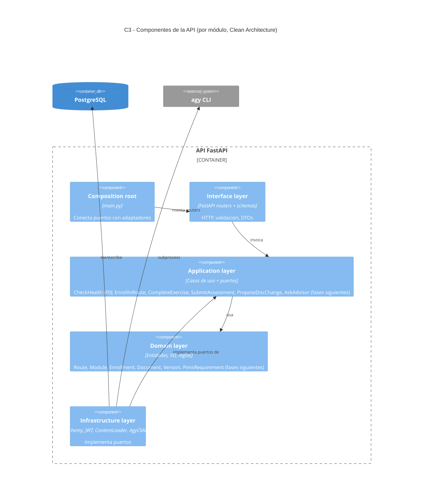

# C4 — Nivel 3: Componentes del API

Regla: `domain` y `application` no importan frameworks de I/O (verificado por `tests/unit/test_architecture.py`).

Módulos previstos: `identity`, `university`, `learning`, `assessment`, `documents`, `analytics`.
Implementado: `health` y `core` (F0); `identity` (registro, login JWT, `/me`, control de rol) y `university` (organigrama, cargos, sistemas, dueños de datos) con su seed (F1); `learning` (rutas, módulos, matrícula con prerrequisitos, 5 tipos de ejercicio corregidos en backend, generadores desde la BD ficticia, progreso y horas) y el `ContentLoader` que sincroniza `content/` (F2).

`documents` (F3): documentos institucionales con versiones inmutables (hash SHA-256 del contenido normalizado), diff por líneas y solicitudes de cambio (proponer → aprobar/rechazar). La aprobación es atómica y usa *compare-and-set* sobre la versión vigente, de modo que dos aprobaciones simultáneas no crean dos versiones. Solo el superadmin resuelve (la dependencia de rol viene de `identity`).

Conjunto documental del PIMS (F4, dentro de `documents`): 11 requisitos (`pims_requirements`, cláusula como dato) ligados a 11 tipos de documento `PIMS_*`. Los documentos tienen ciclo de vida (`in_force`/`draft`) y fecha de revisión; el caso de uso `GetPimsCompleteness` aplica la función pura `evaluate_state` (precedencia missing > draft > expired > unowned > in_force) con un reloj inyectable y expone `/pims/requirements` y `/pims/completeness`.

Rutas 2–4 y evaluación (F5): `learning` añade módulos `planned` (previstos, no accesibles), el ejercicio `soa_form` y el generador `pims_audit_findings`. `assessment` es un módulo nuevo (perfiles `controller`/`processor`): banco de preguntas en `content/assessment/*.json`, intento fijo (preguntas ordenadas por intento), corrección única y resultado por competencia y por requisito del PIMS guardado en `assessments.result`.

Dependencias entre módulos (siempre por puertos, con adaptadores en la capa `infrastructure` del módulo que consume):
- `learning` → `university`: `UniversityFacts` (organigrama, cargos, sistemas).
- `learning` → `documents`: `LearningFacts` compone el snapshot con `GetPimsCompleteness` (estado real del PIMS).
- `assessment` → `documents`: `RequirementCatalog` (`PimsRequirementCatalog` sobre `ListPimsRequirements`) para etiquetar cláusulas.
