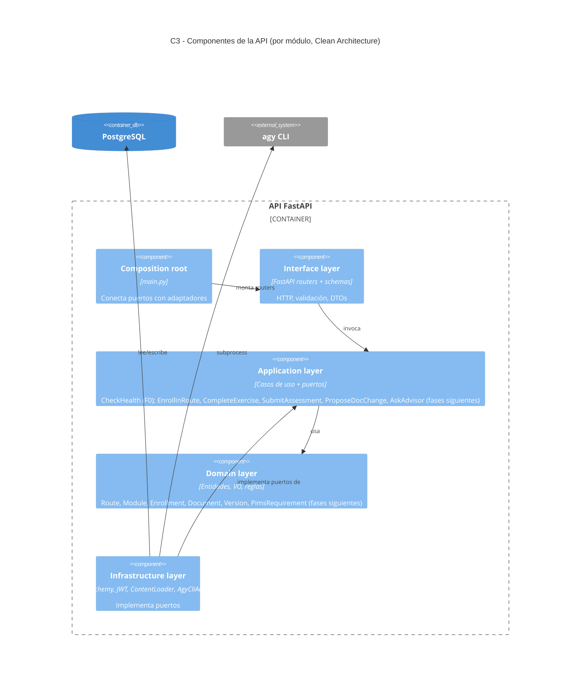

# C4 — Nivel 3: Componentes del API

Regla: `domain` y `application` no importan frameworks de I/O (verificado por `tests/unit/test_architecture.py`).

Módulos previstos: `identity`, `university`, `learning`, `assessment`, `documents`, `analytics`.
Implementado: `health` y `core` (F0); `identity` (registro, login JWT, `/me`, control de rol) y `university` (organigrama, cargos, sistemas, dueños de datos) con su seed (F1).
